<p align="center">
  
</p>

<p align="center">
  
  
  
  
</p>

<br />

```text
00000000: 5674 6869 656e 6e20 2f2f 205a 656e 6e69  Vthienn // Zenni
00000010: 7468 0a4f 6e6c 7920 432e 204e 6f20 6d61  th.Only C. No ma
00000020: 6769 632c 206e 6f20 6761 7262 6167 6520  gic, no garbage 
00000030: 636f 6c6c 6563 746f 722c 206a 7573 7420  collector, just 
00000040: 706f 696e 7465 7273 2061 6e64 206d 656d  pointers and mem
00000050: 6f72 792e 0a                             ory..
```

| `MODULE` | `FOCUS` | `STATUS` |
| :--- | :--- | :--- |
| **`0x01` Core** | C11 / C17, Pointers, Manual Memory Management | `ACTIVE` |
| **`0x02` Systems** | Data Structures, Algorithms, Bitwise & POSIX | `BUILDING` |
| **`0x03` Workspace** | Minimalist CLI Tools & Raw Implementations | `QUEUED` |
